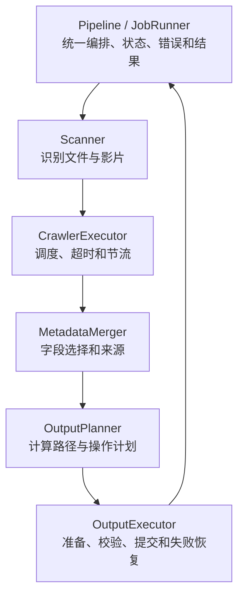

# JavSP 2.0

汇总多站点影片元数据，按命名规则整理本地影片，为 Emby、Jellyfin、Kodi 生成 NFO、封面和海报。

本项目是 [Yuukiy/JavSP](https://github.com/Yuukiy/JavSP) 的社区延续版本，在 [darksoap/JavSP](https://github.com/darksoap/JavSP) 基础上增加 Docker 支持。2.0 将处理流程拆为六个组件，并把影片、字幕与元数据的提交和失败恢复统一管理。

[](https://github.com/FlyAlpaca/JavSP/actions/workflows/tests.yml)
[](https://github.com/FlyAlpaca/JavSP/actions/workflows/docker-build.yml)

[](./LICENSE)

## 功能

- 从文件名或目录识别番号，识别连续分片，支持人工确认和更正。
- 并发抓取多个站点，按配置优先级合并字段，追踪字段来源。
- 翻译标题与简介，统一演员别名和分类标签。
- 下载普通或高清封面，裁剪海报、添加字幕及无码标记，生成 `folder.jpg`。
- 并发下载剧照，匹配 `.srt`、`.ass` 字幕，支持移动或硬链接整理。
- 先准备和校验产物再提交；提交失败时恢复源文件和被替换的元数据。
- 输出成功、失败和未处理影片清单，提供适用于自动化的退出码。

项目提供中文 CLI，不包含 WebUI。详细变化见 [更新日志](./CHANGELOG.md)。

## Docker 快速开始

镜像支持 `linux/amd64` 和 `linux/arm64`。2.0.0 镜像在对应版本发布后可使用以下标签：

```bash
docker run --rm \
  --name javsp \
  -v /path/to/media:/media \
  -v /path/to/config:/app/config \
  ghcr.io/flyalpaca/javsp:2.0.0
```

也可使用 `haobiubiu/javsp:2.0.0`。

| 挂载路径 | 用途 |
| --- | --- |
| `/media` | 待整理影片与输出目录；需要写入权限 |
| `/app/config` | 用户配置目录；需要写入权限 |

首次启动时，如果 `/app/config/config.yml` 不存在，入口脚本会从镜像内的 `/app/config_default.yml` 复制生成它。之后编辑挂载目录中的 `config.yml`，重新运行容器生效。首次生成的文件包含完整默认配置，也可以替换成只包含覆盖项的配置。

无人值守运行建议设置：

```yaml
scanner:
  input_directory: /media
other:
  interactive: false
  auto_exit: true
```

CLI 整理一批影片后退出；持续监听目录不属于当前功能。

| 镜像标签 | 含义 |
| --- | --- |
| `2.0.0` | 固定版本，对应 Git tag `v2.0.0` |
| `latest` | 最近一次发布的稳定版本 |
| `dev` | 手动触发发布工作流的构建 |
| `1.10.2.1` 等 | 历史四段版本标签 |

## 从源码运行

需要 Python 3.11–3.15（项目约束为 `>=3.11,<3.16`）；CI 验证 Python 3.11 和 3.14。Docker 使用 Python 3.14。

```bash
git clone https://github.com/FlyAlpaca/JavSP.git
cd JavSP
git checkout v2.0.0
uv sync --locked
uv run --locked javsp --oscanner.input_directory '/path/to/media'
```

`v2.0.0` 在该版本发布后可用。也可在已取得的源码目录安装并运行：

```bash
python -m pip install .
javsp -c /path/to/config.yml
```

启用 Slimeface 裁剪后端时安装 `crop` 可选依赖，并在配置中选择该引擎。配置字段及注释见 [默认配置](./config_default.yml)。

## 配置

程序始终加载随包发布的 `config_default.yml`，再加载用户覆盖项。不要直接修改默认模板。

```yaml
scanner:
  input_directory: /path/to/media
network:
  proxy_server: null
summarizer:
  move_files: true
  match_subtitles: true
  path:
    output_folder_pattern: '#整理完成/{actress}/[{num}] {title}'
    hard_link: false
translator:
  engine: null
```

### 配置位置和优先级

用户配置查找顺序：当前工作目录、可执行文件目录（仅冻结程序）、源码或安装资源根目录。每个位置优先查找 `config/config.yml`，再查找 `config.yml`。Docker 中对应 `/app/config/config.yml`。

指定 `-c /path/to/config.yml` 后，使用该用户配置文件，不再自动查找其他用户配置。覆盖优先级从低到高为：

1. 包内默认配置。
2. 指定或自动找到的用户配置。
3. 环境变量。
4. 命令行字段覆盖。

环境变量使用 `JAVSP_` 前缀和双下划线区分层级；命令行字段覆盖使用 `--o` 前缀及点号路径，参数名与值之间用空格（不支持等号写法）：

```bash
JAVSP_SCANNER__INPUT_DIRECTORY=/path/to/media uv run --locked javsp
uv run --locked javsp --oscanner.input_directory '/path/to/media' --osummarizer.move_files false
```

### 整理模式

- `move_files: true`：按模板整理影片，并在启用 `match_subtitles` 时移动匹配字幕。
- `move_files: false`：保留影片和字幕，在影片所在目录生成或更新元数据。同目录多部影片会依次更新同名产物，包括 `folder.jpg`。
- `path.hard_link: true`：整理时优先创建硬链接，保留源文件；文件系统不支持或跨设备时回退复制。

默认必需字段为标题和封面。高清封面组全部失败后尝试普通封面；每组最多同时下载三张，采用首个完成且校验有效的结果。剧照最多并发三张，由 `scrap_interval` 控制请求启动间隔，单张失败不阻止其他图片或影片整理。

### R18.dev 本地数据库

在用户配置中加入以下覆盖项即可启用本地库：

```yaml
r18dev:
  enabled: true
crawler:
  online_enabled: true
```

`r18dev.enabled` 默认关闭，`crawler.online_enabled` 默认开启。数据库固定保存在**程序启动工作目录**的 `config/r18dev.sqlite`，没有路径配置项。Docker 对应 `/app/config/r18dev.sqlite`，应保持 `/app/config` 卷持久化。使用 `-c` 指定其他配置文件时，数据库位置仍由启动工作目录决定。

启用后，每次启动先检查 [R18.dev 最新转储](https://r18.dev/dumps)。版本未变时不下载；首次运行下载并导入，后续有新版本时先更新再扫描。已有数据库首次升级时会补建查询索引，可能需要额外磁盘空间和时间。转储是数百 MiB 的压缩文件，导入后的 SQLite 数据库及更新期间的临时库需要更多磁盘空间。下载或更新失败时保留可用旧库；首次下载失败且在线抓取已开启时退回在线抓取，两者都不可用则报错退出。

逐片查询先读本地库；未命中或本地记录的任一可映射字段为空时，才启动已配置的在线站点抓取器。在线结果只填补空白，本地字段优先。关闭在线抓取时仅使用本地数据；两个来源不能同时关闭。本地库未收录的影片在纯本地模式下会整理失败。

## 输出示例

采用默认命名配置整理单片时，输出类似：

```text
#整理完成/
└── 演员名/
    └── [ABC-123] 影片标题/
        ├── ABC-123.mp4
        ├── ABC-123.srt
        ├── movie.nfo
        ├── fanart.jpg
        ├── poster.jpg
        ├── folder.jpg
        └── extrafanart/
            ├── 0.jpg
            └── 1.jpg
```

分片使用 `-CD1`、`-CD2` 等后缀。图片扩展名以实际下载格式为准，也可能是 `.png`、`.webp` 等。`folder.jpg` 使用裁剪和标记后的海报，等比例缩小至不超过 300×450 像素；小图不放大。自定义海报或横版封面已占用 `folder.jpg` 时保留原图。

NFO 的 `genre` 来自自定义分类配置；站点分类与自定义标签写入 `tag`。

## 2.0 处理架构



影片逐部处理，每部影片内部的站点抓取并发执行。翻译位于元数据合并之后、输出规划之前。规划只读计算路径和操作；执行器在临时目录准备产物并校验，再提交影片、字幕和元数据。

抓取超时后停止后续重试，排除超时来源并等待在途线程结束。Python 线程无法被强制终止，因此这里的超时不是整个任务的硬截止时间。

## 失败恢复与退出码

影片目标已存在时整理失败，避免覆盖影片；字幕目标已存在时警告并跳过，保留源字幕。已有 NFO 和图片允许更新，提交前先保留备份。

运行期间发生异常或取消时，执行器逆序恢复已移动的影片和字幕、被替换的元数据，并删除本次新增产物。恢复成功的普通单片失败不会阻止下一部影片；取消或恢复不完整会停止批次，并列出未处理影片。

恢复不完整时，日志会给出 `.javsp-*` 恢复目录，其中的 `recovery.json` 记录原始错误、未恢复操作和相关路径。保留这些目录及对应文件，按清单人工处理后再运行。

恢复仅覆盖当前进程运行期间；断电或强制终止后不会自动恢复。多文件提交不具有目录级原子可见性。

退出码针对已识别并进入整理队列的影片；扫描跳过项记录在日志中。

| 退出码 | 含义 |
| --- | --- |
| `0` | 本批次影片全部整理成功 |
| `1` | 存在整理失败、取消、恢复不完整，或未找到可处理影片等启动错误 |

## 从 1.x 升级

- 继续使用现有 `config.yml`，配置字段和命名模板保持兼容，无需迁移脚本。
- 输出目录和主要产物命名保持一致；失败时恢复范围扩大到本次生成或替换的元数据。
- 不兼容的输出路径重叠会提前报错；检查自定义模板是否把不同产物写入同一文件。
- Docker 可固定使用 `2.0.0`，保留原来的 `/media` 和 `/app/config` 挂载。
- 本地安装后刷新项目包，使安装元数据、运行日志和 Git 版本保持一致：

```bash
uv sync --locked --reinstall-package javsp
# pip 安装环境使用：
python -m pip install --no-deps --force-reinstall .
```

## 开发与反馈

组件接口、测试和构建命令见 [开发指南](./docs/development.md)。默认测试离线运行；在线抓取测试需要显式启用，并可能更新样本。

[问题反馈](https://github.com/FlyAlpaca/JavSP/issues) · [功能建议](https://github.com/FlyAlpaca/JavSP/issues/new/choose) · [上游 Wiki](https://github.com/Yuukiy/JavSP/wiki)

## 许可与使用约定

保留原项目及社区贡献者的署名与许可。本项目受 [GPL-3.0](./LICENSE) 与 [Anti 996 License](https://github.com/996icu/996.ICU/blob/master/LICENSE_CN) 约束。使用本项目还须接受以下条款：

- 本软件仅供学习 Python 和技术交流使用。
- 请勿在微博、微信等墙内公共社交平台宣传本项目。
- 使用时遵守当地法律法规。
- 禁止用于商业用途。
